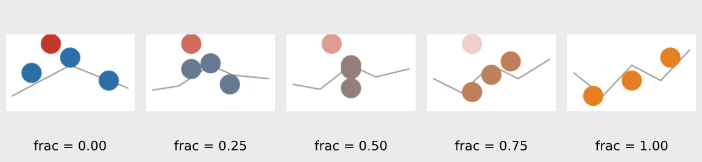

# Keyframe animation in the engine

vellum animates by tweening between **keyframes**: you give it a few
finished scenes and a schedule of in-between frames, and it interpolates
each frame from the two keyframes around it and encodes the result. It
does not run any code between frames, so this is keyframe animation, not
a live runtime.

This is the engine level. A grammar layer drives it for you:
[vellumplot](https://r-vellum.github.io/vellumplot/)’s `animate()`
builds the keyframes from your data and the schedule from an easing
curve. Read on if you want to animate your own scenes, or to know what
the engine does with a grammar’s keyframes.

## Keyframes

Keyframes are ordinary scenes, all the same pixel size. Here are three
states of a small chart: three keyed points and a line. The point keyed
`"d"` exists only in the middle keyframe, and the line has a different
number of vertices in each keyframe.

``` r

state <- function(x, y, col, line_y, extra = FALSE) {
  s <- vl_scene(2, 1.2, dpi = 96, bg = "white") |>
    draw(lines_grob(seq(0.05, 0.95, length.out = length(line_y)), line_y,
                    gp = vl_gpar(col = "grey60", lwd = 2), key = "trend")) |>
    draw(points_grob(x, y, size = vl_unit(4, "mm"), key = c("a", "b", "c"),
                     gp = vl_gpar(fill = col, col = NA)))
  if (extra) {
    s <- s |> draw(points_grob(0.35, 0.88, size = vl_unit(4, "mm"), key = "d",
                               gp = vl_gpar(fill = "#c0392b", col = NA)))
  }
  s
}

keyframes <- list(
  state(c(0.2, 0.5, 0.8), c(0.3, 0.3, 0.3), "#2c6fa6", c(0.2, 0.2)),
  state(c(0.2, 0.5, 0.8), c(0.5, 0.7, 0.4), "#2c6fa6", c(0.2, 0.6, 0.3), extra = TRUE),
  state(c(0.8, 0.5, 0.2), c(0.7, 0.4, 0.2), "#e67e22", c(0.5, 0.2, 0.6, 0.4, 0.8))
)
```

## How marks are matched

Marks are matched across keyframes by their data `key`, the same keys
interactivity uses, not by where they sit in the scene. A mark keyed
`"a"` in one keyframe tweens into the mark keyed `"a"` in the next,
wherever that is drawn. So the order of rows does not matter, and a
point that changes group slides and recolours.

What has no partner enters or leaves:

- a keyed mark with no partner **fades** in or out;
- unkeyed nodes (axes, gridlines, labels) pair in order with nodes of
  the same viewport, kind and role. If their number differs between the
  two keyframes, they **switch** whole at the midpoint.

A matched line, polygon or path whose vertex count changes **morphs**:
both outlines are put on one common set of vertices along their length,
so the morph starts and ends exactly on the keyframes. Colours
interpolate perceptually, in the Oklab colour space. Discrete
attributes, such as a line type or a label’s string, switch at the
midpoint.

[`vl_tween_pairing()`](https://r-vellum.github.io/vellum/reference/vl_tween_pairing.md)
reports how each pair of adjacent keyframes will tween, before anything
is rendered:

``` r

vl_tween_pairing(keyframes)
#>   from to paired nodes_from nodes_to snapped exited entered
#> 1    1  2   TRUE          2        3       0      0       1
#> 2    2  3   TRUE          3        2       0      1       0
```

Point `"d"` enters between keyframes 1 and 2 and exits between 2 and 3.
Nothing snaps: the line morphs from 2 to 3 to 5 vertices.

## A schedule, and the animation

The schedule says, for each output frame, which pair of keyframes it
lies between (`seg`, the 1-based index of the left keyframe) and how far
along it is (`frac`, from 0 to 1). The fraction is already eased: apply
any easing curve you like before passing it in.

``` r

n <- 12
ease <- function(t) t * t * (3 - 2 * t)  # smoothstep
seg <- c(rep(1:2, each = n), rep(2, 6))  # two moves, then hold the last keyframe
frac <- c(rep(ease((0:(n - 1)) / n), 2), rep(1, 6))
length(seg)
#> [1] 30
```

Each move runs from fraction 0 up to, but not including, 1, because the
next move starts on that keyframe. The six frames at the end hold the
last keyframe.

``` r

gif <- tempfile(fileext = ".gif")
vl_render_animation(keyframes, seg, frac, gif, fps = 12)
file.size(gif)
#> [1] 47460
```

The frames are rendered and encoded in parallel in the Rust backend.
`format` can be `"gif"`, `"apng"`, `"svg"` (an animated SVG) or
`"frames"` (a directory of PNG files);
[`vignette("output-formats")`](https://r-vellum.github.io/vellum/articles/output-formats.md)
compares them. `fps` need not be a whole number: `12.5` or `0.5` are
kept exactly.

## One frame as a still

[`vl_render_frame()`](https://r-vellum.github.io/vellum/reference/vl_render_frame.md)
draws the frame
[`vl_render_animation()`](https://r-vellum.github.io/vellum/reference/vl_render_animation.md)
would draw for one schedule entry and writes it as a still image (PNG,
SVG or PDF): a poster for the animation, a thumbnail, or the frame to
print. Here are five frames of the second move, side by side:

``` r

fracs <- c(0, 0.25, 0.5, 0.75, 1)
files <- vapply(fracs, function(f) {
  vl_render_frame(keyframes, seg = 2, frac = f, tempfile(fileext = ".png"))
}, character(1))

sheet <- vl_scene(6, 1.4, dpi = 96, bg = "grey92")
for (i in seq_along(files)) {
  sheet <- sheet |>
    draw(raster_grob(files[i], x = (i - 0.5) / 5, y = 0.55,
                     width = vl_unit(1.1, "in"), height = vl_unit(0.66, "in"))) |>
    draw(text_grob(sprintf("frac = %.2f", fracs[i]), x = (i - 0.5) / 5, y = 0.1,
                   gp = vl_gpar(fontsize = 8)))
}
display(sheet)
```



The points slide and turn orange, the red point fades out, and the line
morphs from three vertices to five.

## Easing each property separately

`frac` drives positions and every discrete switch. Three optional
schedules, `frac_col`, `frac_size` and `frac_alpha`, drive colour, size
and opacity (including the enter and exit fades) on curves of their own.
Here the points move on the eased curve while their colour changes
linearly:

``` r

lin <- c(rep((0:(n - 1)) / n, 2), rep(1, 6))
vl_render_animation(keyframes, seg, frac, "a.gif", frac_col = lin)
```

Leaving them `NULL` uses `frac` for everything, and gives exactly the
same output as passing `frac` four times.

## Text that changes every frame

Keyframes fix a label’s text, so a title showing the current year would
only change at keyframes. `text_variants` and `text_frame` swap in a
different string on every frame: `text_variants` is a list of scenes
holding keyed text grobs, and `text_frame` says which variant each frame
uses. A frame’s keyed text takes the string and layout of the variant’s
text with the same key, while its position and colour stay as the tween
put them.

``` r

years <- 2001:2030
variants <- lapply(years, function(y) {
  vl_scene(2, 1.2, dpi = 96) |> draw(text_grob(as.character(y), key = "year"))
})
vl_render_animation(keyframes, seg, frac, "a.gif",
                    text_variants = variants, text_frame = seq_along(seg))
```

Shape each string with the same font and size as the label it replaces.

## Reduced motion

An animated SVG honours `prefers-reduced-motion`. A reader who has asked
their system not to animate sees one still frame: the last one when the
schedule ends on the final keyframe, so they get the complete picture,
and the first one otherwise. The GIF and APNG formats cannot do this.

## Where to go next

- [`?vl_render_animation`](https://r-vellum.github.io/vellum/reference/vl_render_animation.md):
  the full matching rules and every argument.
- [`vignette("output-formats")`](https://r-vellum.github.io/vellum/articles/output-formats.md):
  GIF, APNG and animated SVG compared, with file sizes.
- vellumplot’s `animate()`: the same engine, driven from a plot.
