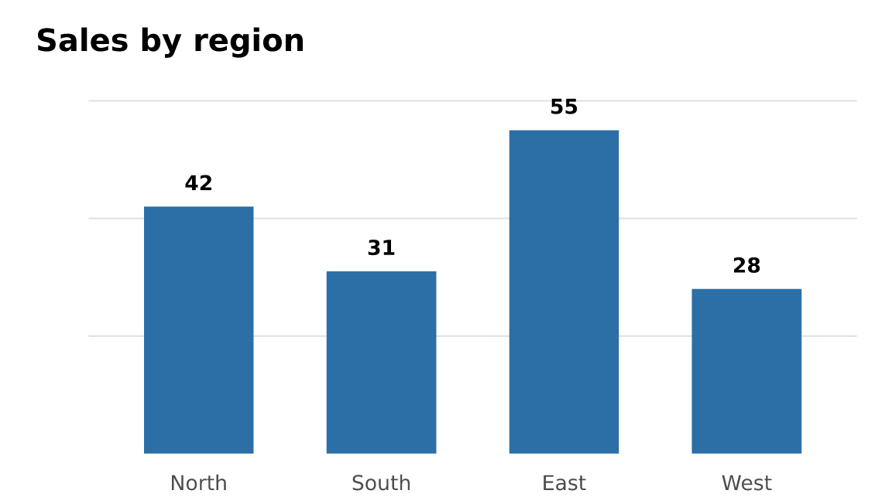

# Editable PowerPoint output

A picture of a plot pasted into a slide can only be resized. vellum
writes a scene to PowerPoint as **editable shapes** instead: every mark
is a DrawingML shape you can select, recolour or move, every label is a
text box you can retype, and every named panel is a group you can
ungroup. The layout is the one vellum solved for the PNG, SVG and PDF,
so the slide matches the other formats.

You need no other package to write a deck. officer is optional, for
putting a scene on a slide of a deck you build with it.

## A scene on a slide

Here is a small chart, built as an ordinary scene:

``` r

region <- c("North", "South", "East", "West")
sales <- c(42, 31, 55, 28)

alt <- "Bar chart of unit sales. East is highest at 55, West lowest at 28."

chart <- vl_scene(6, 3.4, dpi = 96, bg = "white",
                  title = "Sales by region", desc = alt) |>
  draw(text_grob("Sales by region", x = 0.04, y = 0.92, just = "left",
                 gp = vl_gpar(fontsize = 15, fontface = "bold"))) |>
  push(vl_viewport(x = 0.53, y = 0.45, width = 0.86, height = 0.7,
                   xscale = c(0.4, 4.6), yscale = c(0, 60), name = "panel")) |>
  draw(segments_grob(0, vl_unit(c(20, 40, 60), "native"),
                     1, vl_unit(c(20, 40, 60), "native"),
                     gp = vl_gpar(col = "grey88"))) |>
  draw(rect_grob(x = vl_unit(1:4, "native"), y = vl_unit(sales / 2, "native"),
                 width = vl_unit(0.6, "native"), height = vl_unit(sales, "native"),
                 gp = vl_gpar(fill = "#2c6fa6", col = NA),
                 key = region)) |>
  draw(text_grob(md(paste0("**", sales, "**")), x = vl_unit(1:4, "native"),
                 y = vl_unit(sales + 4, "native"), gp = vl_gpar(fontsize = 10))) |>
  draw(text_grob(region, x = vl_unit(1:4, "native"), y = vl_unit(-5, "native"),
                 gp = vl_gpar(fontsize = 10, col = "grey30"))) |>
  pop()

display(chart)
```



[`render()`](https://r-vellum.github.io/vellum/reference/vl_scene.md)
writes it to a one-slide PowerPoint file when the path ends in `.pptx`.
The slide is the size of the scene.

``` r

path <- tempfile(fileext = ".pptx")
render(chart, path)
```

To see what went in, list the shapes on the slide. A `.pptx` file is a
zip archive, and the slide is an XML file inside it:

``` r

slide_xml <- function(path, n = 1) {
  dir <- tempfile()
  utils::unzip(path, exdir = dir)
  paste(readLines(file.path(dir, "ppt", "slides", sprintf("slide%d.xml", n)),
                  warn = FALSE), collapse = "")
}
count <- function(x, pattern) lengths(regmatches(x, gregexpr(pattern, x)))

x <- slide_xml(path)
c(groups = count(x, "<p:grpSp[ >]"), shapes = count(x, "<p:sp>"),
  pictures = count(x, "<p:pic>"))
#>   groups   shapes pictures 
#>        2       15        0
regmatches(x, gregexpr("<a:t>[^<]*</a:t>", x))[[1]]
#> [1] "<a:t>Sales by region</a:t>" "<a:t>42</a:t>"             
#> [3] "<a:t>31</a:t>"              "<a:t>55</a:t>"             
#> [5] "<a:t>28</a:t>"              "<a:t>North</a:t>"          
#> [7] "<a:t>South</a:t>"           "<a:t>East</a:t>"           
#> [9] "<a:t>West</a:t>"
```

There are two groups, one for the whole scene and one for the viewport
named `"panel"`, and no pictures. The shapes are the bars, the gridlines
and the text boxes. The text is real text: the title, the bar labels and
the region names are text runs PowerPoint can edit. The `**bold**` of an
[`md()`](https://r-vellum.github.io/vellum/reference/md.md) label stays
bold, and each styled span of a rich label is a run of its own.

## Several slides

[`pptx_pages()`](https://r-vellum.github.io/vellum/reference/pptx_pages.md)
writes a deck with one slide per scene. A presentation has a single
slide size, so the deck takes the largest scene’s size and centres any
smaller scene on its slide.

``` r

small <- vl_scene(4, 2.4, dpi = 96, bg = "white") |>
  draw(circle_grob(r = 0.3, gp = vl_gpar(fill = "#2c6fa6", col = NA))) |>
  draw(text_grob("a second slide", y = 0.1, gp = vl_gpar(fontsize = 12)))

deck <- tempfile(fileext = ".pptx")
pptx_pages(list(chart, small), deck)
```

The file is byte-for-byte reproducible: it carries no timestamp, user
name or software version, so writing the same scenes twice gives the
same bytes. With `path = NULL`,
[`pptx_pages()`](https://r-vellum.github.io/vellum/reference/pptx_pages.md)
returns those bytes instead of writing a file.

``` r

identical(pptx_pages(list(chart, small)), pptx_pages(list(chart, small)))
#> [1] TRUE
```

That makes a deck safe to commit and to compare in a test, the same way
vellum’s PNG and PDF output are.

## Slides built with officer

If you build decks with
[officer](https://davidgohel.github.io/officer/), a scene goes straight
into
[`officer::ph_with()`](https://davidgohel.github.io/officer/reference/ph_with.html).
vellum registers the method when officer is loaded; officer and xml2 are
suggested packages, not dependencies.

``` r

doc <- officer::read_pptx()
doc <- officer::add_slide(doc, layout = "Title and Content", master = "Office Theme")
doc <- officer::ph_with(doc, "Quarterly sales",
                        location = officer::ph_location_type("title"))
doc <- officer::ph_with(doc, chart, location = officer::ph_location_type("body"))
print(doc, target = tempfile(fileext = ".pptx"))
```

By default the scene is laid out again at the size of the placeholder
(`resize = TRUE`), exactly as
[`render()`](https://r-vellum.github.io/vellum/reference/vl_scene.md)
would lay it out at that size. Text keeps its point size and nothing is
stretched. `resize = FALSE` keeps the scene’s own size, anchored at the
placeholder’s top-left corner.

Anything else
[`as_vellum_scene()`](https://r-vellum.github.io/vellum/reference/as_vellum_scene.md)
can compile goes in through
[`as_dml()`](https://r-vellum.github.io/vellum/reference/as_dml.md). For
a [vellumplot](https://r-vellum.github.io/vellumplot/) plot:

``` r

library(vellumplot)
p <- vplot(mtcars) |> mark_point(x = wt, y = mpg)

doc <- officer::ph_with(doc, as_dml(p), location = officer::ph_location_type("body"))

# or without officer
render_plot(p, "cars.pptx")
pptx_pages(list(p, p), "deck.pptx")
```

## Text and fonts

A text box names the font vellum measured its label with. PowerPoint
uses that font when the machine opening the deck has it, and substitutes
another when it does not. The box is anchored at the label’s anchor, so
a wider substitute font grows away from it: right-aligned tick labels
stay right-aligned. Vertically, the text sits on the box’s bottom edge
whatever the label’s justification. LibreOffice assumes a fixed line,
1.0 em above the baseline and 0.2 em below, whatever the font, so a
label sits where vellum draws it when the font’s descent is about 0.2 em
and lower by the excess for a deeper one (Avenir Next, Hoefler Text).
Keynote follows the font’s own metrics; PowerPoint itself has not been
checked. Fonts are not embedded.

`text = "outline"` (in
[`render()`](https://r-vellum.github.io/vellum/reference/vl_scene.md),
[`pptx_pages()`](https://r-vellum.github.io/vellum/reference/pptx_pages.md),
[`as_dml()`](https://r-vellum.github.io/vellum/reference/as_dml.md) and
[`officer::ph_with()`](https://davidgohel.github.io/officer/reference/ph_with.html))
writes the glyph outlines instead. The slide then looks the same on
every machine, but the labels can no longer be edited as text.

Some labels are outlines in either mode, as in SVG:

| label | in PowerPoint |
|----|----|
| plain text | a text run |
| [`md()`](https://r-vellum.github.io/vellum/reference/md.md) label | a text run per styled span (bold, italic, colour; `^sup^` and `~sub~` as raised or lowered runs) |
| [`md()`](https://r-vellum.github.io/vellum/reference/md.md) label with inline `$math$` | outlines |
| [`tex()`](https://r-vellum.github.io/vellum/reference/tex.md) and [`plotmath()`](https://r-vellum.github.io/vellum/reference/plotmath.md) labels | outlines |
| text with a halo | outlines |
| text on a path ([`text_path_grob()`](https://r-vellum.github.io/vellum/reference/text_path_grob.md)) | outlines |

## What stays a shape, and what becomes a picture

DrawingML is a smaller drawing model than vellum’s, so a few features
are translated, and a few are drawn as a picture.

- **Shapes.** Paths, polygons and lines become freeform shapes baked to
  slide coordinates. Axis-aligned rectangles and circles stay preset
  rectangles and ellipses. Strokes keep their width, cap, join and dash,
  and colours keep their alpha.
- **Points.** A layer of points is written as a few shapes instead of
  one per point: points of one style that do not overlap share a shape,
  so a 10,000-point scatter is a few hundred shapes. Each is still an
  editable freeform.
- **Clipping.** DrawingML cannot clip, so clipped geometry is cut in
  advance. Fills are cut to their visible area, strokes along their
  centre line, and pictures are cropped. A native text label crossing a
  clip edge is drawn whole, with a warning; outlined text is cut
  exactly.
- **Gradients and patterns.** Linear and radial gradients become native
  gradient fills (a radial gradient’s focal point moves to its centre,
  with a warning). A
  [`vl_pattern()`](https://r-vellum.github.io/vellum/reference/vl_pattern.md)
  fill becomes a tiled picture fill. A
  [`vl_hatch()`](https://r-vellum.github.io/vellum/reference/vl_hatch.md)
  fill is geometry, so it stays shapes.
- **Group opacity.** Opacity over shapes that do not overlap is folded
  into their colours, which is what the group would composite to.
- **Pictures.** Masks, blend modes, blur and shadow effects, and group
  opacity over overlapping shapes cannot be expressed. Each is drawn
  through the raster backend as a picture of the region it covers, with
  a warning. The slide looks right, but that part cannot be edited.
  Rasters are pictures too.

``` r

masked <- vl_scene(3, 2, dpi = 96, bg = "white") |>
  push(vl_viewport(mask = as_mask(circle_grob(r = 0.4, gp = vl_gpar(fill = "black"))))) |>
  draw(rect_grob(gp = vl_gpar(fill = "#2c6fa6", col = NA))) |>
  pop()
render(masked, "masked.pptx")
#> Warning: This render could not be fully reproduced on the target backend:
#> • masks are drawn as a picture of the region they cover
```

LibreOffice is not a reliable preview for some of these. It drops
gradients with translucent stops and the transparency of tiled pattern
pictures, and places an off-centre radial gradient differently. Check
the deck in PowerPoint itself.

For a chart whose *data* stays editable in PowerPoint, see the
[mschart](https://ardata-fr.github.io/mschart/) package. vellum writes
the drawing, not the data behind it.

## Alt text

A scene’s `title` and `desc`, set in
[`vl_scene()`](https://r-vellum.github.io/vellum/reference/vl_scene.md)
or with
[`describe()`](https://r-vellum.github.io/vellum/reference/describe.md),
become the name and the alt text of the group that holds the slide’s
shapes. With no `desc`, the title is the alt text too:

``` r

regmatches(x, regexpr('<p:cNvPr [^>]*descr="[^"]*"/>', x))
#> [1] "<p:cNvPr id=\"2\" name=\"Sales by region\" descr=\"Bar chart of unit sales. East is highest at 55, West lowest at 28.\"/>"
```

That is the text in PowerPoint’s Alt Text pane. Through
[`officer::ph_with()`](https://davidgohel.github.io/officer/reference/ph_with.html)
the group takes the placeholder’s name instead of the title, and keeps
the alt text. Per-mark `role` and `name`, which build a tagged PDF’s
structure tree, are not written to the slide; see
[`vignette("accessible-output")`](https://r-vellum.github.io/vellum/articles/accessible-output.md).

## Where to go next

- [`vignette("output-formats")`](https://r-vellum.github.io/vellum/articles/output-formats.md):
  how PowerPoint compares with PNG, SVG and PDF.
- [`?as_dml`](https://r-vellum.github.io/vellum/reference/as_dml.md) and
  [`?pptx_pages`](https://r-vellum.github.io/vellum/reference/pptx_pages.md):
  the full reference.
