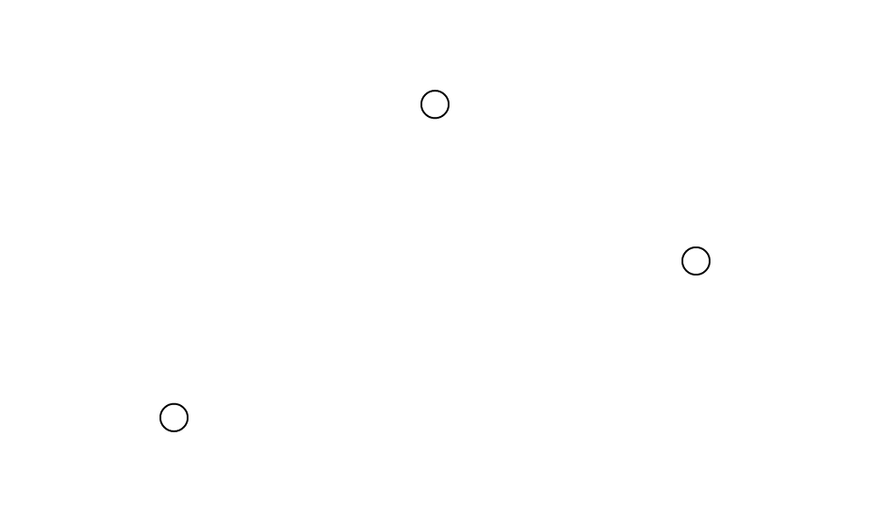
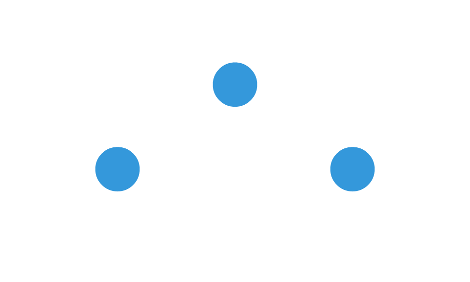

# The scene contract: what vellumplot and vellumwidget depend on

vellum is the backend for a small ecosystem:
[vellumplot](https://r-vellum.github.io/vellumplot/) compiles a grammar
of graphics *into* a vellum scene, and
[vellumwidget](https://r-vellum.github.io/vellumwidget/) turns a
rendered scene into an interactive HTML widget. Both bind to a narrow
seam:
[`scene_model()`](https://r-vellum.github.io/vellum/reference/scene_model.md),
[`scene_svg()`](https://r-vellum.github.io/vellum/reference/scene_svg.md),
and the per-element metadata that rides on grobs. Above the
SVG-comfortable element count a host switches to a rasterised base
layer, and takes those pixels from
[`scene_png()`](https://r-vellum.github.io/vellum/reference/scene_png.md)
(raw bytes, no temp file) — part of the same seam. Because the three
packages are version-locked and co-released, a change to that seam can
break the layers above it silently.

**This article is the authoritative description of that seam.** If you
are building on vellum, or changing vellum’s output, this is the
contract to hold to. (It supersedes the internal design note
`_docs/DESIGN-INTERACTIVITY.md`, which is kept only as history.)

## The seam, in one picture

      vellumplot  ──compiles a plot to grobs carrying──▶  key / meta / id / role
                                                            │
      vellum  ──renders──▶  scene_svg()   (data-key, data-vellum-*, role attrs)
                            scene_model()  (per-element table: identity + bbox)
                            scene_png()    (raw PNG bytes, for the raster-base mode)
                                                            │
      vellumwidget  ──reads scene_svg() + scene_model()──▶  hover / select / brush / link

Everything below the grammar is *pure metadata*: a static PNG/SVG render
never calls
[`scene_model()`](https://r-vellum.github.io/vellum/reference/scene_model.md),
and a grob without a `key`/`meta` still draws exactly as before. Nothing
here changes what is painted.

## Carrying identity on a grob

Eleven constructors take two optional identity arguments: the batched
marks
[`points_grob()`](https://r-vellum.github.io/vellum/reference/grob.md),
[`circle_grob()`](https://r-vellum.github.io/vellum/reference/grob.md),
[`rect_grob()`](https://r-vellum.github.io/vellum/reference/grob.md),
[`segments_grob()`](https://r-vellum.github.io/vellum/reference/grob.md),
[`hexagon_grob()`](https://r-vellum.github.io/vellum/reference/grob.md),
[`sector_grob()`](https://r-vellum.github.io/vellum/reference/grob.md),
[`roundrect_grob()`](https://r-vellum.github.io/vellum/reference/grob.md)
and
[`text_grob()`](https://r-vellum.github.io/vellum/reference/grob.md),
and the single-shape marks
[`lines_grob()`](https://r-vellum.github.io/vellum/reference/grob.md),
[`polygon_grob()`](https://r-vellum.github.io/vellum/reference/grob.md)
and
[`path_grob()`](https://r-vellum.github.io/vellum/reference/grob.md).

- `key`: a character vector of **data keys**. This is the join key a
  host uses to tie an on-screen element back to a datum.
- `meta`: a list of **free-form per-element records**, e.g. a tooltip
  string or field values. It can also be given **columnar**: a data
  frame with one row per element and one column per field. Row `i`
  stands for the record of that row’s values (a `NULL` entry in a
  list-column leaves its field out of the record), and it costs far less
  than a list of records when there are many elements.

On a batched mark both are per element and must have **length 1**
(shared by every element) **or exactly the element count**; any other
length is an error naming the argument, never a silent truncation or
wrap. A single-shape mark is one element, so it takes a single `key` and
a single `meta` record.

Every grob also takes `id` and `role` (a single value per grob) for
semantic identity and accessibility. The remaining constructors
([`bezier_grob()`](https://r-vellum.github.io/vellum/reference/grob.md),
[`spline_grob()`](https://r-vellum.github.io/vellum/reference/grob.md),
[`loop_grob()`](https://r-vellum.github.io/vellum/reference/grob.md),
[`raster_grob()`](https://r-vellum.github.io/vellum/reference/grob.md),
[`svg_grob()`](https://r-vellum.github.io/vellum/reference/vl_svg_path.md),
[`text_path_grob()`](https://r-vellum.github.io/vellum/reference/text_path_grob.md),
[`contour_grob()`](https://r-vellum.github.io/vellum/reference/vl_contour.md))
take no `key` and never appear in the tables below.

### Coordinates: bare numbers are npc

A bare number passed to any constructor’s position or size argument is
read in `default_units`, which is `"npc"` (a fraction of the enclosing
viewport) everywhere, as in grid. A grammar layer placing data values
inside a panel viewport with an `xscale`/`yscale` must therefore say so,
either with `vl_unit(x, "native")` or `default_units = "native"`:

``` r

panel <- vl_scene(3, 2, bg = "white") |>
  push(vl_viewport(name = "panel", xscale = c(0, 10), yscale = c(0, 100))) |>
  draw(points_grob(
    x = c(2, 5, 8),
    y = c(20, 80, 50),
    default_units = "native",
    key = c("a", "b", "c")
  )) |>
  pop()
panel
```



Arguments with a physical default keep it whatever `default_units` says:
a bare point, hexagon or loop `size`, `foot`, `start_cap`, `end_cap` and
`offset` are millimetres. Only the reading of *bare* numbers changes; a
\[vl_unit()\] is never reinterpreted.

``` r

s <- vl_scene(5, 3, bg = "white") |>
  draw(points_grob(
    x    = c(0.25, 0.5, 0.75),
    y    = c(0.4, 0.7, 0.4),
    size = vl_unit(6, "mm"),
    gp   = vl_gpar(fill = "#3498db", col = NA),
    key  = c("a", "b", "c"),
    meta = list(
      list(tooltip = "first"),
      list(tooltip = "second"),
      list(tooltip = "third")
    )
  ))
s
```



(Each batched grob carries one graphical style; the grammar layer above
vellum emits one grob per style bucket, so a scatter with three colours
is three
[`points_grob()`](https://r-vellum.github.io/vellum/reference/grob.md)s.
The `key`/`meta` machinery is per element regardless.)

## `scene_model()`: the per-element table

[`scene_model()`](https://r-vellum.github.io/vellum/reference/scene_model.md)
walks the rendered scene and returns a list of **two data frames**.

``` r

m <- scene_model(s)
names(m)
#> [1] "elements" "panels"
```

### `elements`

One row per drawn element of the *keyable* marks, **in paint order**:

``` r

str(m$elements)
#> 'data.frame':    3 obs. of  14 variables:
#>  $ key  : chr  "a" "b" "c"
#>  $ mark : chr  "point" "point" "point"
#>  $ id   : chr  NA NA NA
#>  $ name : chr  NA NA NA
#>  $ panel: chr  NA NA NA
#>  $ x0   : num  97.3 217.3 337.3
#>  $ y0   : num  150.1 63.7 150.1
#>  $ x1   : num  143 263 383
#>  $ y1   : num  195 109 195
#>  $ x    : num  120 240 360
#>  $ y    : num  172.8 86.4 172.8
#>  $ w    : num  45.4 45.4 45.4
#>  $ h    : num  45.4 45.4 45.4
#>  $ meta :List of 3
#>   ..$ :List of 1
#>   .. ..$ tooltip: chr "first"
#>   ..$ :List of 1
#>   .. ..$ tooltip: chr "second"
#>   ..$ :List of 1
#>   .. ..$ tooltip: chr "third"
```

The columns are the contract:

| column | type | meaning |
|----|----|----|
| `key` | character | the data key (`NA` if the element was drawn without one) |
| `mark` | character | the mark kind (see vocabulary below) |
| `id` | character | the grob `id` (`NA` if unset) |
| `name` | character | the grob `name` (`NA` if unset) |
| `panel` | character | the innermost enclosing named viewport (`NA` if none) |
| `x0, y0, x1, y1` | numeric | device-pixel bounding box |
| `x, y` | numeric | element centre, `(x0+x1)/2, (y0+y1)/2` |
| `w, h` | numeric | element size, `x1-x0, y1-y0` |
| `meta` | list | the free-form per-element record (list-column; see below for the columnar form) |

`scene_model(scene, meta = "columns")` returns the same table with
`meta` as a **data-frame column** instead: one row per element and one
column per field. A field is a plain vector when every element carrying
it holds one atomic value of one type (`NA` for the elements without
it), and a list-column (`NULL` where absent) otherwise. A host that
reads meta for many elements (vellumwidget does) asks for this form, so
no per-element record is ever built.

``` r

scene_model(s, meta = "columns")$elements$meta
#>   tooltip
#> 1   first
#> 2  second
#> 3   third
```

The `mark` vocabulary is these eleven values, and only these: `rect`,
`point`, `circle`, `hexagon`, `sector`, `segment`, `roundrect`, `text`,
`path`, `line`, `polygon`. Adding one is a contract change (see the end
of this article).

Three families produce these rows:

- **Batched marks** (`rect`, `point`, `circle`, `hexagon`, `sector`,
  `segment`) emit **one row per element, always**, even when unkeyed
  (then `key` is `NA`).
- **Keyed-only batches** (`roundrect`, `text`) emit **one row per keyed
  element**. A grob drawn without `key` contributes no rows at all, and
  within a keyed grob an element whose key is `NA` or `""` is skipped.
  This keeps a plot’s unkeyed axis labels and strip backgrounds out of
  the table.
- **Single-shape marks** (`path`, `line`, `polygon`) emit **one row per
  grob, and only when keyed**. An unkeyed path/line/polygon is
  geometry-only and does not appear in the table. (A single `sf`
  feature, one polygon or linestring, is exactly one such element.) Key
  one with the constructor’s `key` argument (setting the grob’s `@keys`
  slot is equivalent).

### `panels`

One row per **named panel** that encloses at least one row of `elements`
(a named viewport becomes an addressable panel; one with no elements in
the table has no row). An element’s `panel` is its innermost enclosing
named viewport.

``` r

str(m$panels)
#> 'data.frame':    0 obs. of  14 variables:
#>  $ name     : chr 
#>  $ x0       : num 
#>  $ y0       : num 
#>  $ x1       : num 
#>  $ y1       : num 
#>  $ px0      : num 
#>  $ py0      : num 
#>  $ px1      : num 
#>  $ py1      : num 
#>  $ xscale_lo: num 
#>  $ xscale_hi: num 
#>  $ yscale_lo: num 
#>  $ yscale_hi: num 
#>  $ meta     : list()
```

Columns:

| column | type | meaning |
|----|----|----|
| `name` | character | the panel’s viewport name |
| `x0, y0, x1, y1` | numeric | bounding box of the panel’s *elements* (device px) |
| `px0, py0, px1, py1` | numeric | the panel viewport’s **resolved device-px rectangle** — the true data region, from the layout solve, not just where marks landed (`NA` if the viewport was not captured) |
| `xscale_lo, xscale_hi` | numeric | the panel viewport’s native x coordinate range (its `xscale`) |
| `yscale_lo, yscale_hi` | numeric | native y coordinate range (its `yscale`) |
| `meta` | list | the panel viewport’s free-form `meta` (list-column; `NULL` when none) |

The pixel rectangle paired with the native range gives the affine that
maps device px ↔︎ native for that panel — the geometry a host needs to
invert a pixel back to a data coordinate. It is the panel-level analogue
of an element’s bbox + `meta`.

The panel-level `meta` (the `meta =` argument of \[vl_viewport()\]) is
the same opaque, host-read channel as element `meta`: vellum carries it
untouched and names no conventions. The grammar uses it for panel-scoped
descriptors — e.g. the `scales` descriptor `vellumplot` attaches to each
data panel (per-axis type, domain, breaks, and labels), which
`vellumwidget` reads to map pixels back to data values. That convention
is documented by `vellumplot`, not here.

### The `meta` key vocabulary

vellum treats `meta` as opaque: it is a free-form list, recycled to the
element count and carried through untouched; vellum does **not** name or
validate its keys. The following key names are **conventions** the
grammar (vellumplot) writes and the widget (vellumwidget) reads.
Documenting them here keeps the three layers in step; they are not
enforced by vellum.

| `meta` key | written by | read by | purpose |
|----|----|----|----|
| `tooltip` | vellumplot `tooltip=` | vellumwidget | hover tooltip text (falls back to `key`) |
| `data_id` | vellumplot `data_id=` | (becomes the `key`) | the data key for an element |
| `hover_group` | vellumplot `hover_group=` | vellumwidget | co-highlight a group on hover |
| `hover_color` | vellumplot mark aesthetic | vellumwidget | per-element hover outline colour |
| `selected_color` | vellumplot mark aesthetic | vellumwidget | per-element selection colour |
| `legend` | vellumplot legend keying | vellumwidget | the series a mark belongs to |
| `legend_for` | vellumplot legend keying | vellumwidget | the series a legend swatch drives (`"<aes>:<level>"`) |

If you add a convention, add it here.

## `element_geometry()`: the hit-test geometry

[`scene_model()`](https://r-vellum.github.io/vellum/reference/scene_model.md)
gives boxes, which suit a rectangular brush and mislead for anything
diagonal, thin or holed. A host that hit-tests on the client (a browser
cannot call back into R on every mouse move) reads
[`element_geometry()`](https://r-vellum.github.io/vellum/reference/element_geometry.md)
once instead: the device-pixel geometry of every **keyed** element,
recorded by the same walk that renders the scene, so a segment drawn
with an `offset` or end caps is reported where it lands.
[`vl_nearest()`](https://r-vellum.github.io/vellum/reference/vl_nearest.md)
measures against exactly this geometry, so a client that follows the
rules below reproduces it.

``` r

holed <- vl_scene(4, 3, dpi = 100) |>
  draw(path_grob(
    x = c(0.1, 0.9, 0.9, 0.1, 0.4, 0.6, 0.6, 0.4),
    y = c(0.1, 0.1, 0.9, 0.9, 0.4, 0.4, 0.6, 0.6),
    id = rep(1:2, each = 4),
    rule = "evenodd",
    key = "donut"
  ))
element_geometry(holed)
#>     key kind vertex ring   x   y    rule
#> 1 donut path      1    1  40 270 evenodd
#> 2 donut path      2    1 360 270 evenodd
#> 3 donut path      3    1 360  30 evenodd
#> 4 donut path      4    1  40  30 evenodd
#> 5 donut path      5    2 160 180 evenodd
#> 6 donut path      6    2 240 180 evenodd
#> 7 donut path      7    2 240 120 evenodd
#> 8 donut path      8    2 160 120 evenodd
```

One row per vertex. The columns are the contract:

| column | type | meaning |
|----|----|----|
| `key` | character | the element’s data key (repeated on each of its vertices) |
| `kind` | character | `segment`, `line`, `polygon`, `path`, `hexagon`, `sector`, `point`, `rect`, `roundrect`, `text` (a [`circle_grob()`](https://r-vellum.github.io/vellum/reference/grob.md) element reports as `point`) |
| `vertex` | integer | 1-based within the element; restarts at 1 for the next element |
| `ring` | integer | 1-based ring (or polyline) within the element |
| `x, y` | numeric | device px, y down |
| `rule` | character | the fill rule, per element: `"nonzero"`, `"evenodd"`, or `NA` for a kind with no interior (`segment`, `line`, `point`) |

The rules a client applies, which are the ones
[`vl_nearest()`](https://r-vellum.github.io/vellum/reference/vl_nearest.md)
applies:

- `segment` and `line` are open centre-lines: the distance is to the
  nearest edge, and an `NA` vertex is a break.
- `point` is a single centre; its radius is half the smaller side of its
  [`scene_model()`](https://r-vellum.github.io/vellum/reference/scene_model.md)
  box.
- `rect` and `roundrect` are two opposite box corners, filled as
  `"nonzero"`.
- Everything else (`polygon`, `path`, `hexagon`, `sector`, and a `text`
  label’s box) is closed rings. **Containment is decided once, across
  all of an element’s rings, under its `rule`**: even-odd parity of the
  edge crossings, or a nonzero sum of the rings’ winding numbers. Inside
  is distance zero. Outside – and a point in a hole is outside – the
  distance is to the nearest edge of any ring. Rings are never joined:
  each closes on itself.

`rule` comes from the grob: `path_grob(rule = "evenodd")` reports
`"evenodd"`, and `rule = "winding"` (the default) and every other filled
kind report `"nonzero"`.
[`vl_nearest()`](https://r-vellum.github.io/vellum/reference/vl_nearest.md)
and
[`hit_test()`](https://r-vellum.github.io/vellum/reference/hit_test.md)
both decide containment by that rule, so a click in the hole of an
even-odd path is outside it, and
[`hit_test()`](https://r-vellum.github.io/vellum/reference/hit_test.md)
falls through to whatever is drawn beneath:

``` r

vl_nearest(holed, 0.5, 0.5)$dist # in the hole: outside, so a positive distance
#> [1] 30
vl_nearest(holed, 0.2, 0.5)$dist # in the ring: inside
#> [1] 0
is.null(hit_test(holed, 0.5, 0.5)) # nothing under the hole
#> [1] TRUE
```

## `scene_svg()`: the emitted attributes

[`scene_svg()`](https://r-vellum.github.io/vellum/reference/scene_svg.md)
returns the same scene as an SVG string. Interactivity rides on SVG
attributes; the raster and PDF backends ignore all of them.

``` r

svg <- scene_svg(s)
# the data-key attributes on the three points:
regmatches(svg, gregexpr('data-key="[^"]*"', svg))[[1]]
#> [1] "data-key=\"a\"" "data-key=\"b\"" "data-key=\"c\""
```

Six attributes, each emitted only when its source is set:

| attribute | source | scope | set from |
|----|----|----|----|
| `data-key` | grob `key` | per element | `points_grob(key=)` etc. (every constructor that takes `key`) |
| `data-vellum-id` | grob `id` | per grob/node | `*_grob(id=)` |
| `data-vellum-name` | grob `name` | per grob/node | `*_grob(name=)` |
| `role` | grob `role` | per grob/node | `*_grob(role=)` |
| `data-vellum-panel` | named viewport | wrapping `<g>` | `vl_viewport(name=)` |
| `data-vellum-pan` | pannable panel’s inner group | inner `<g>` | `vl_viewport(pannable=)` |

An empty/`NULL` source emits **no attribute**, so a scene that declares
no interactivity is byte-for-byte identical to one built before any of
this existed.

### Pannable panels

A named viewport marked `vl_viewport(pannable = TRUE)` is emitted as
**two nested groups** instead of one: an outer
`<g data-vellum-panel="name">` that carries the panel’s clip
(untransformed, so the clip region stays fixed) around an inner
`<g data-vellum-pan="name">` holding the content. The panel’s clip is
**hoisted once** to the outer group (rather than repeated per element),
so a host can set a `transform` on the inner group to pan/zoom the marks
while the clip — and the axes/legend outside the panel — stay put. This
is the structural basis for host-side axis-aware zoom. It is SVG-only
and inert for static rendering (the extra group has no transform until a
host sets one); non-pannable panels and other backends are unchanged.

## Accessibility

A scene carries an optional accessible **name** and **description**, set
with `vl_scene(title=, desc=)` or `describe(scene, title=, desc=)`. When
present:

- the **SVG** root becomes `<svg role="img" aria-labelledby="…">` with
  `<title>` and `<desc>` children (the reliable screen-reader pattern;
  WCAG 1.1.1);
- the **PDF** is a **tagged PDF**: the chart is a `Figure` in the
  structure tree whose `Alt` is the description.

This is additive: with no title/desc the output is unchanged. The
grammar layer (`vellumplot`) sets these automatically from the plot’s
title and an auto-generated (or `labs(alt=)`) alt text. See vellumplot’s
[Accessibility
article](https://r-vellum.github.io/vellumplot/articles/accessibility.html).
Per-element `role` (above) is a genuine ARIA role; the interactive
widget layer (`vellumwidget`) adds keyboard navigation and live-region
announcements on top.

## Invariants the contract guarantees

These are the properties vellumplot and vellumwidget are entitled to
rely on, and that vellum’s own tests (`tests/testthat/test-contract.R`)
pin down:

1.  **Paint order.** `scene_model()$elements` is in draw order, and the
    SVG emits elements in the same order. A host can zip the SVG DOM and
    the table positionally.
2.  **Semantic/geometry agreement.**
    [`scene_model()`](https://r-vellum.github.io/vellum/reference/scene_model.md)
    builds the identity columns from the R grob tree and the geometry
    columns from the compiled backend, then asserts they enumerate the
    same elements: the element counts must match and the `key` column
    must be identical at every position. A mismatch is a hard error (a
    compiler bug), never a silent mis-join.
3.  **Additivity.** `key`/`meta`/`id`/`role` never change what is drawn.
    A render with no keys is identical to the same scene without the
    machinery, on every backend.
4.  **Stable `id` join key.** A grob’s `id` surfaces as `data-vellum-id`
    in the SVG *and* is the join key vellumplot records in its
    provenance table, so a widget can map an SVG node to the grammar
    record that produced it.

## For contributors

If you change any of the following, update this article and the contract
tests in the same commit, and expect to co-release vellumplot and
vellumwidget:

- the `elements`/`panels` column set or types,
- the
  [`element_geometry()`](https://r-vellum.github.io/vellum/reference/element_geometry.md)
  column set, its `kind` and `rule` vocabularies, or the containment
  rule above,
- the `mark` vocabulary,
- which marks are keyable, or the batched / keyed-only / single-shape
  rules,
- the `key`/`meta` length rule (1 or the element count),
- the default reading of bare numbers (`default_units = "npc"`),
- the SVG attribute names, or when they are emitted,
- the reserved `meta` key vocabulary. \`\`\`
